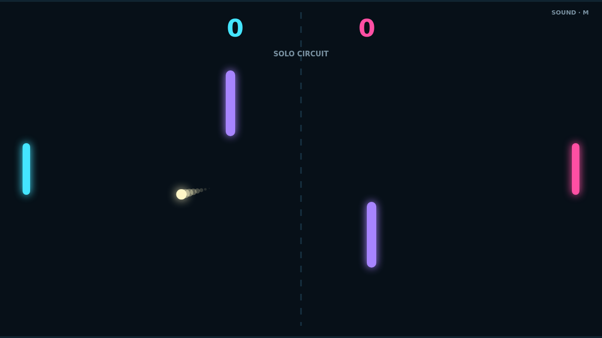

# Carom

Carom is a neon paddle duel where every return is a chance to reshape the rally. The ball starts fast, accelerates with each paddle strike, and turns open space into a contest of timing.

Move through contact to load the ball with spin. Its path keeps bending after the hit, letting a simple return curl away from an opponent or settle into an unexpected angle.

Two violet blockers split the center of the field into bank-shot lanes. Clip one to redirect a rally, curve around another, or bait your rival toward the wrong opening.

Play Solo against a reactive opponent or share the keyboard in Versus. The first side to 11 wins—but only with a two-point lead, so match point can become a long, sharp duel.

